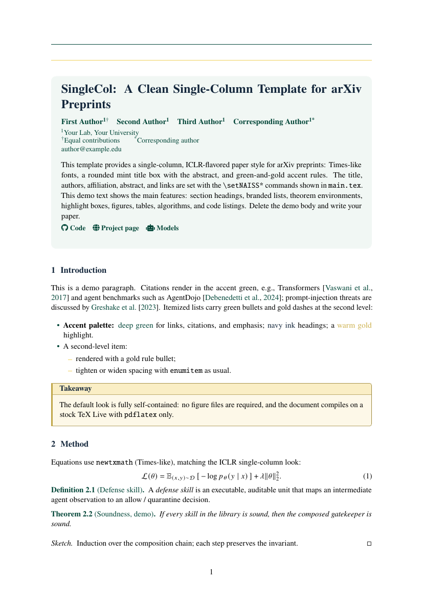

# Single-Column Paper Template for arXiv Preprints

A clean, single-column LaTeX template for arXiv preprints, in the spirit of
the ICLR camera-ready look: Times-like fonts, a rounded title box with the
abstract, and green-and-gold accent rules. No class files, no shell-escape —
one `.sty` and `pdflatex`.



## Files

| File | Purpose |
|---|---|
| `naiss-hku-template.sty` | The template (load this). Self-contained. |
| `main.tex` | Demo paper showing every feature; replace the demo body. |
| `references.bib` | Sample bibliography. |

## Quick start

```bash
pdflatex main && bibtex main && pdflatex main && pdflatex main
# or: latexmk -pdf main
```

Copy the folder, edit the metadata block in `main.tex`, delete the demo
sections, write your paper:

```latex
\setNAISSTitle{...}
\setNAISSAuthors{First Author\textsuperscript{1} \quad ...}
\setNAISSAffiliation{\textsuperscript{1}Your Affiliation}
\setNAISSEmail{author@example.edu}
\setNAISSAbstract{...}
\setNAISSLinks{\faGithub\ Code \quad \faGlobe\ Project page} % optional
\begin{document}
\NAISSMakeTitle
\NAISSMakeAbstract
```

## Options

```latex
\usepackage{naiss-hku-template}                % A4 (default), unbranded
\usepackage[letterpaper]{naiss-hku-template}   % US Letter (ICLR-like)
\usepackage[branded]{naiss-hku-template}       % branded page head + mark
```

`[branded]` adds a logo lockup at the top left and a wordmark at the top
right of the page head, plus a corner mark inside the title box. Logo files
are picked up automatically if present and skipped gracefully if not:

- `figures/naiss-logo.pdf` — left lockup / title-box corner mark; falls back
  to a built-in TikZ mark, so the document always compiles.
- `figures/hku-logo.pdf` (or `figures/hku-logo.png`) — top-right wordmark;
  falls back to plain text.

A near-square mark looks best in the title-box corner; wide marks suit the
page head. Export logos as PDF with transparent backgrounds when possible.
Brand assets are kept out of version control; add them locally when using
`[branded]`.

## Colors

| Color | Hex | LaTeX |
|---|---|---|
| Deep green (accent) | `#024638` | `NAISSGreen` |
| Soft mint | `#D7EBE5` | `NAISSSoft` |
| Tint background | `#F1F7F4` | `NAISSTint` |
| Warm gold | `#F0CF59` | `NAISSGold` |
| Navy ink (headings) | `#13263B` | `NAISSInk` |
| Secondary text | `#3E5366` | `NAISSMuted` |

All links, citations, caption labels, and theorem headers use the accent
green. Recolor globally by redefining `NAISSGreen` after loading the
package.

## Environments

- `naissbox[title]` — mint box with a green left rule.
- `naissgoldbox[title]` — pale gold box with a gold left rule (takeaways).
- Theorems (amsthm, numbered by section): `theorem`, `lemma`, `proposition`,
  `corollary`, `definition`, `assumption`, `example`, plus unnumbered
  `remark`.

`natbib` is loaded, so `\citep` / `\citet` work out of the box (`plainnat`
fits the style). Captions are styled small with bold green labels; itemize
bullets are colored to match.

## arXiv notes

- Upload `main.tex`, the `.sty`, the `.bbl` (or `references.bib`), and your
  figure files.
- The template needs `pdflatex` only and compiles on a stock TeX Live —
  including when optional logo files are missing.

## Credits

Title-block layout is adapted from the single-column style popularized by
arXiv:2608.27990 (`astaple-polyu-template`). MIT licensed.
